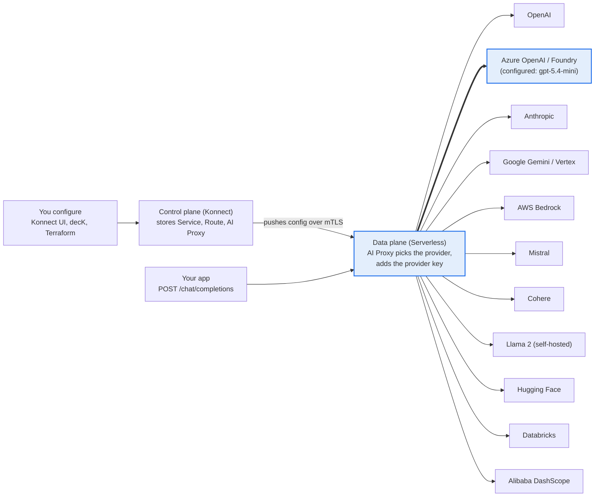

# Kong Konnect AI Gateway 2.0

Route OpenAI-style requests through a Kong Konnect **Serverless** gateway to an Azure AI Foundry deployment (`gpt-5.4-mini`). This repo has the full setup guide plus config as code for **decK** and **Terraform**.

## Contents

- [Architecture](#architecture)
- [Repository layout](#repository-layout)
- [Key values](#key-values)
- [Prerequisites](#prerequisites)
- [Step 1: Control plane](#step-1-create-the-control-plane)
- [Step 2: Data plane](#step-2-get-a-data-plane)
- [Step 3A: AI Proxy on the Serverless API Gateway (working setup)](#step-3a-ai-proxy-on-the-serverless-api-gateway-working-setup)
- [Step 3B: AI Gateway 2.0 (Model Provider + AI Model)](#step-3b-ai-gateway-20-model-provider--ai-model)
- [Step 4: decK](#step-4-config-as-code-with-deck)
- [Step 4b: Terraform](#step-4b-automate-everything-with-terraform)
- [Step 5: Test](#step-5-test)
- [Step 6: Secure and harden](#step-6-secure-and-harden)
- [Troubleshooting](#troubleshooting)

## Architecture

Apps call **only the data plane** (the proxy URL). The data plane applies the config pushed by the **control plane** (Konnect) and forwards each request to an LLM provider. Both planes are required; with a Serverless gateway Kong runs both.



Azure is the provider configured here. The others are providers Kong's AI Proxy plugin supports; switching is a change of `model.provider`, model options and auth.

There are two ways to build this in Konnect:

| Path | Where you configure | Status in this account |
| --- | --- | --- |
| **A. AI Proxy plugin** on a Serverless API Gateway | API Gateway → Service → Route → AI Proxy plugin | **Working**: `https://4b1ed59e0a.us.serverless.gateways.konggateway.com/chat/completions` |
| **B. AI Gateway 2.0** (Model Provider + AI Model) | AI Gateway → Providers, Models | Config saved, but no data plane was provisioned (proxy DNS returns NXDOMAIN) |

## Repository layout

| Path | Purpose |
| --- | --- |
| `README.md` | This guide |
| `deck/kong.yaml` | decK declarative config: Service, Route, AI Proxy plugin |
| `terraform/main.tf` | Azure Foundry resource + deployment; Kong Service, Route, AI Proxy, Key Auth, consumer |
| `terraform/variables.tf` | Inputs (subscription, resource group, region, names, control plane ID) |
| `terraform/outputs.tf` | Proxy URL and the generated client API key |
| `terraform/terraform.tfvars.example` | Template for your `terraform.tfvars` (git-ignored) |
| `.gitignore` | Keeps keys, `*.tfvars` and Terraform state out of git |

## Key values

| Item | Value |
| --- | --- |
| Konnect region | US (`https://us.api.konghq.com`) |
| Serverless control plane | `serverless-api-gateway-demo` (ID `5e42f6e0-73d1-4f2e-a9dc-bd210184514e`) |
| Proxy URL | `https://4b1ed59e0a.us.serverless.gateways.konggateway.com` |
| Azure resource (instance) | `srinipolagani-8291-resource` |
| Azure deployment | `gpt-5.4-mini` (Global Standard, 150 RPM / 150K TPM, model version 2026-03-17) |
| Azure API version | `2025-04-01-preview` |
| AI Gateway (Path B) | `AI-Gateway`, ID `35d895bb-08ce-48c3-ae48-00ffaea68dc1` |

## Prerequisites

- [ ] **Konnect account** at [cloud.konghq.com](https://cloud.konghq.com), US region. If you have more than one organization, build everything in one; entities in one org are invisible from the other.
- [ ] **Azure AI Foundry resource** with a model deployed. In [ai.azure.com](https://ai.azure.com) → Models + endpoints, copy the deployment **Name** (here `gpt-5.4-mini`). Use the deployment name, not the model name.
- [ ] **Azure key**: Azure Portal → your resource → Keys and Endpoint → Key 1 or Key 2.
- [ ] **Resource name** from the endpoint: `https://<resource>.cognitiveservices.azure.com` → `<resource>` is the Azure instance.
- [ ] **Public network access** enabled on the Azure resource (Serverless gateways have no private connectivity).
- [ ] For config as code: a **Konnect personal access token** (profile → Personal access tokens), plus `deck` (`brew install kong/deck/deck`) or `terraform` + `az`.
- [ ] For testing: `curl` and optionally `jq`.

## Step 1: Create the control plane

The control plane stores your config. You manage it through the Konnect UI, decK or Terraform, and never send app traffic to it.

**Path A: Serverless API Gateway**

1. Konnect sidebar → **API Gateway** → **New** → **New API Gateway**.
2. Choose **Serverless**, enter a name (e.g. `serverless-api-gateway-demo`), click **Create**.
3. Open it → **Overview**. Copy the **Proxy URL** (`https://<id>.us.serverless.gateways.konggateway.com`). This is the only URL apps call.

**Path B: AI Gateway 2.0**

1. Konnect sidebar → **AI Gateway** → **New AI gateway**.
2. Choose deployment type **Serverless**, enter a name (e.g. `AI-Gateway`), create it.
3. Open it → **Connect** → copy the **Public edge DNS** address. That is its proxy URL.

> Do not call the **Admin API** / `*.cp.konghq.com` address shown on the Overview page. It is the control plane endpoint and returns `mTLS headers missing` to normal clients.

## Step 2: Get a data plane

No data plane means no proxy URL and nothing serves requests.

| Option | Who runs it | How to get it | Best for |
| --- | --- | --- | --- |
| **Serverless** | Kong | Created automatically with a Serverless gateway | Quick start; 100 req/s, 10 MB body limit, public only |
| **Dedicated Cloud Gateway** | Kong | Gateway → Data plane nodes → configure cloud data plane; pick region and size | Production, private networking; may need a paid plan |
| **Self-hosted** | You (Docker / Kubernetes) | Gateway → Data plane nodes → New data plane node → copy generated command | Local testing, full control |

**Serverless (Path A, used here)**

1. Nothing to install. After Step 1, wait about 30 seconds.
2. Check the proxy hostname resolves: `nslookup 4b1ed59e0a.us.serverless.gateways.konggateway.com` must return IP addresses.
3. `curl -i https://<proxy-url>/` should return Kong's `no Route matched` JSON. That proves the data plane is live.

**Self-hosted Docker (if Serverless is unavailable)**

1. Gateway → **Data plane nodes** → **New data plane node** → platform **Docker** (or macOS).
2. Click **Generate certificate**, then copy the generated `docker run` command. It contains the control plane endpoints and certificates and looks like this:

   ```bash
   docker run -d --name kong-dp -p 8000:8000 -p 8443:8443 \
     -e KONG_ROLE=data_plane -e KONG_DATABASE=off -e KONG_KONNECT_MODE=on \
     -e KONG_CLUSTER_MTLS=pki \
     -e KONG_CLUSTER_CONTROL_PLANE=<id>.us.cp.konghq.com:443 \
     -e KONG_CLUSTER_SERVER_NAME=<id>.us.cp.konghq.com \
     -e KONG_CLUSTER_TELEMETRY_ENDPOINT=<id>.us.tp.konghq.com:443 \
     -e KONG_CLUSTER_TELEMETRY_SERVER_NAME=<id>.us.tp.konghq.com \
     -e KONG_CLUSTER_CERT="<generated cert>" -e KONG_CLUSTER_CERT_KEY="<generated key>" \
     -e KONG_LUA_SSL_TRUSTED_CERTIFICATE=system \
     <image shown in Konnect>
   ```

3. Run it, then check **Data plane nodes** shows the node as **Connected**.
4. Your proxy URL is `http://localhost:8000`.

This certificate-based connection is the mTLS the control plane requires, which is why a plain `curl` to `*.cp.konghq.com` fails.

**Path B note:** the Serverless AI Gateway in this account never got a data plane. Its edge DNS `b9d624f9a5.gateways.konggateway.com` returns NXDOMAIN and Data plane nodes is empty. Raise it with Kong support (chat bubble in Konnect) quoting gateway ID `35d895bb-08ce-48c3-ae48-00ffaea68dc1`, or attach a self-hosted data plane.

## Step 3A: AI Proxy on the Serverless API Gateway (working setup)

Three entities on `serverless-api-gateway-demo` route `/chat/completions` to Azure. This is the setup that returned HTTP 200 from `gpt-5.4-mini`.

**1. Gateway Service**: Gateway → **Gateway services** → **New gateway service** → Full URL

| Field | Value |
| --- | --- |
| Full URL | `https://srinipolagani-8291-resource.openai.azure.com` |
| Name | `azure-foundry` |

AI Proxy builds the real Azure path, but the Service still needs a URL.

**2. Route**: Gateway → **Routes** → **New route** → Basic

| Field | Value |
| --- | --- |
| Name | `azure-chat` |
| Gateway service | `azure-foundry` |
| Path | `/chat/completions` |
| Strip path | on (default) |

**3. AI Proxy plugin**: Route `azure-chat` → **Plugins** → **New plugin** → **AI Proxy** (scoped to the route)

| Section | Field | Value |
| --- | --- | --- |
| Plugin configuration | Route type | `llm/v1/chat` |
| Model | Provider | `azure` |
| Model | Name | `gpt-5.4-mini` |
| Model → Options (toggle on) | Azure instance | `srinipolagani-8291-resource` |
| Model → Options | Azure API version | `2025-04-01-preview` (replace the default `2023-05-15`) |
| Model → Options | Azure deployment ID | `gpt-5.4-mini` |
| Show additional settings → Auth (toggle on) | Header name | `api-key` |
| Auth | Header value | your Azure key (no `Bearer` prefix) |

Click **Save** at the bottom (close the Konnect chat bubble if it covers the button). The page must switch to the Plugins list showing **AI Proxy · Route · Enabled**; if it stays on "Create Plugin", it was not saved.

For the Responses API, add a second Route with path `/responses` and a second AI Proxy plugin with route type `llm/v1/responses`.

## Step 3B: AI Gateway 2.0 (Model Provider + AI Model)

The newer model-centric UI. This config is saved in the account as model `gpt-foundry` → `azure-foundry: gpt-5.4-mini`; it serves traffic only once the AI Gateway has a working data plane (Step 2).

**1. Model Provider**: AI Gateway → **Providers** → New

| Field | Value |
| --- | --- |
| Provider | Azure |
| Service | Azure OpenAI (or Azure AI Foundry if listed) |
| Name | `azure-foundry` |
| Azure instance | `srinipolagani-8291-resource` |
| Authentication | Provided by AI gateway |
| Authentication method | API key |
| Key source | Enter a key (or Token Vault for production) |
| Header name | `api-key` |
| API key | your Azure key |
| Parameter name / value / location | leave blank |

**2. AI Model**: AI Gateway → **Models** → New

| Form step | Field | Value |
| --- | --- | --- |
| 1. General information | Display name | `gpt-foundry` (clients send this as `model`) |
| 2. Target models | Provider | `azure-foundry` |
| 2. Target models | Target model | `gpt-5.4-mini` |
| 2. Target models → Advanced fields | Azure deployment ID | `gpt-5.4-mini` (required) |
| 2. Target models → Advanced fields | Azure API version | `2025-04-01-preview` |
| 3. Capabilities | Enable | Generate (`/chat/completions`), Agentic (`/responses`); format OpenAI |
| 4. Routing | Base path | blank or e.g. `/azure` |
| 4. Routing | Model alias / match location | defaults |
| 5. Authentication and access | Auth strategy | API key (or none while testing) |
| 6. Advanced configuration | — | defaults |

**3. Call it**: the model's **Connect** tab shows a template with `<YOUR_DP_HOST>`. Replace it with the AI Gateway's Public edge DNS (Step 1, Path B), not the Admin API address:

```bash
curl -X POST "https://<AI-gateway-edge-DNS>/chat/completions" \
  -H 'Content-Type: application/json' \
  -d '{"model":"gpt-foundry","messages":[{"role":"user","content":"Hello"}]}'
```

## Step 4: Config as code with decK

`deck/kong.yaml` applies Step 3A from a file, so the setup is repeatable and versioned.

```bash
export KONNECT_TOKEN="kpat_..."
export DECK_AZURE_KEY="<Azure key>"   # decK only substitutes DECK_* variables

deck gateway diff deck/kong.yaml \
  --konnect-addr https://us.api.konghq.com \
  --konnect-token $KONNECT_TOKEN \
  --konnect-control-plane-name serverless-api-gateway-demo

deck gateway sync deck/kong.yaml \
  --konnect-addr https://us.api.konghq.com \
  --konnect-token $KONNECT_TOKEN \
  --konnect-control-plane-name serverless-api-gateway-demo
```

- `sync` makes Konnect match the file exactly and deletes anything not in it. Always `diff` first.
- Export what is live: `deck gateway dump -o current.yaml` with the same flags (`current.yaml` is git-ignored).
- A clean re-run of `diff` shows 0 creates, 0 updates, 0 deletes.

## Step 4b: Automate everything with Terraform

One `terraform apply` creates the Azure resource and deployment, then wires Kong to it using the key Azure returns, so no key is ever typed. Use either Terraform or decK for the Kong entities, never both.

| Layer | Terraform provider | Resources |
| --- | --- | --- |
| Azure Foundry resource + deployment | `hashicorp/azurerm` | `azurerm_cognitive_account`, `azurerm_cognitive_deployment` |
| Kong control plane | `kong/konnect` | existing one passed by ID (or the Serverless Cloud Gateway resource) |
| Service, Route, AI Proxy | `kong/konnect` | `konnect_gateway_service`, `konnect_gateway_route`, `konnect_gateway_plugin_ai_proxy` |
| Key Auth + consumer | `kong/konnect` | `konnect_gateway_plugin_key_auth`, `konnect_gateway_consumer`, `konnect_gateway_key_auth` |
| AI Gateway 2.0 models/providers | none found | use `kongctl` or the Konnect API |

```bash
cd terraform
cp terraform.tfvars.example terraform.tfvars   # fill in subscription, resource group, region
export KONNECT_TOKEN="kpat_..."
az login
terraform init
terraform validate
terraform plan
terraform apply
terraform output -raw app_api_key             # key for client apps
```

**Adopting what already exists.** The Azure resource, deployment and Kong entities were created by hand. Import them, or delete the Kong entities in the UI first so Terraform can create them:

```bash
terraform import azurerm_cognitive_account.foundry \
  /subscriptions/<sub>/resourceGroups/<rg>/providers/Microsoft.CognitiveServices/accounts/srinipolagani-8291-resource
terraform import azurerm_cognitive_deployment.gpt \
  /subscriptions/<sub>/resourceGroups/<rg>/providers/Microsoft.CognitiveServices/accounts/srinipolagani-8291-resource/deployments/gpt-5.4-mini
```

**Before you rely on it**

- Run `terraform validate` first. The Konnect attribute names follow Kong's published examples; pin the provider version and check the [Konnect provider docs](https://registry.terraform.io/providers/Kong/konnect/latest/docs) for that version.
- The Azure key and the consumer key land in Terraform state. Use an encrypted remote backend (Azure Storage, Terraform Cloud); never commit `*.tfstate`.
- Serverless control planes can also be created in Terraform (the provider lists a Serverless Cloud Gateway resource); passing the existing ID is simpler and keeps the current proxy URL.
- AI Gateway 2.0 (Step 3B) models and providers had no Terraform resources in Kong's docs; manage them with `kongctl` or the Konnect API.
- Rotating the key: `az cognitiveservices account keys regenerate ...`, then `terraform apply` updates the plugin.

## Step 5: Test

A working call returns HTTP 200, a header `x-kong-llm-model: azure/gpt-5.4-mini`, and a reply in `choices[0].message.content`. Wait about 15 seconds after any config change.

1. Data plane is up (expect `no Route matched` before Step 3):

   ```bash
   curl -i https://4b1ed59e0a.us.serverless.gateways.konggateway.com/
   ```

2. Chat completion through Kong:

   ```bash
   curl -i -X POST "https://4b1ed59e0a.us.serverless.gateways.konggateway.com/chat/completions" \
     -H 'Content-Type: application/json' \
     -d '{"messages":[{"role":"user","content":"How does Kong AI Gateway work?"}]}'
   ```

3. Just the answer:

   ```bash
   curl -s -X POST "https://4b1ed59e0a.us.serverless.gateways.konggateway.com/chat/completions" \
     -H 'Content-Type: application/json' \
     -d '{"messages":[{"role":"user","content":"Say hello in 5 words"}]}' \
     | jq -r '.choices[0].message.content'
   ```

4. After adding Key Auth (Step 6), add `-H 'apikey: <consumer-key>'`; without it you should get 401.
5. Konnect → gateway → **Analytics** shows the requests within a minute or two.

| Header to check | Meaning |
| --- | --- |
| `x-kong-llm-model: azure/gpt-5.4-mini` | AI Proxy handled the request |
| `x-ms-served-model` | The Azure model version that answered |
| `x-ratelimit-remaining-requests` | Azure quota left this minute (limit 150) |
| `x-kong-upstream-latency` | Time spent in Azure, ms |

## Step 6: Secure and harden

The route is open until you add auth: anyone with the URL spends your Azure quota.

- [ ] **Rotate Azure keys** regularly: Azure Portal → Keys and Endpoint → Regenerate, then update the plugin's Header value (or `DECK_AZURE_KEY` and re-sync, or `terraform apply`).
- [ ] **Add Key Auth**: Route `azure-chat` → Plugins → **Key Auth**. Then **Consumers** → New consumer → Credentials → Key Auth → generate a key. Clients send `apikey: <key>`.
- [ ] **Rate limit** under Azure's 150 requests/min: **Rate Limiting** (e.g. 100/minute) or **AI Rate Limiting Advanced** for token-based limits.
- [ ] **Store the key in a vault**: Konnect Config Store / vault, referenced from Header value instead of plain text.
- [ ] **Restrict methods** on the route to `POST`.
- [ ] **Turn on Log statistics** in AI Proxy to see token usage and cost in Analytics.

## Troubleshooting

| Error | Cause | Fix |
| --- | --- | --- |
| `mTLS headers missing` / `missing headers in request` | Called the control plane (Admin API, `*.cp.konghq.com`) | Call the proxy URL / Public edge DNS instead |
| `getaddrinfo ENOTFOUND <id>.gateways.konggateway.com` | AI Gateway has no data plane; DNS name never created | Check Data plane nodes; ask Kong support or attach a self-hosted data plane |
| `Client network socket disconnected before secure TLS connection` | Wildcard host resolves but no gateway serves that ID | Same as above |
| `must set 'model.options.azure_deployment_id' for azure provider` | Deployment ID missing on the model target | Target → Advanced fields → Azure deployment ID = `gpt-5.4-mini` |
| `no Route matched with those values` | Data plane live, but no Route for that path | Create the Route (Step 3A) |
| HTTP 200 with empty body, no `x-kong-llm-model` header | AI Proxy plugin not saved; request went to Azure root | Save the plugin; confirm it shows in the Plugins list |
| 401 from Azure | Wrong or empty key, or wrong header | Header `api-key` + raw key, or `Authorization` + `Bearer <key>`; check `DECK_AZURE_KEY` |
| 404 `DeploymentNotFound` | Typo in instance or deployment ID | Match Foundry exactly |
| 429 from Azure | Over 150 requests/min on the deployment | Add a rate limit in Kong or raise Azure quota |
| Entities "disappear" or a page logs you out | Two Konnect organizations; resources live in one | Use the org switcher; build everything in one org |
